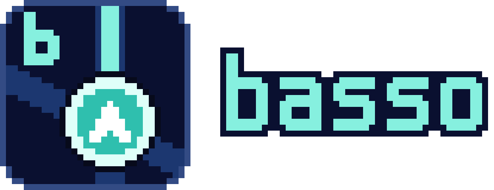
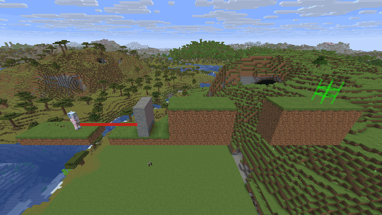
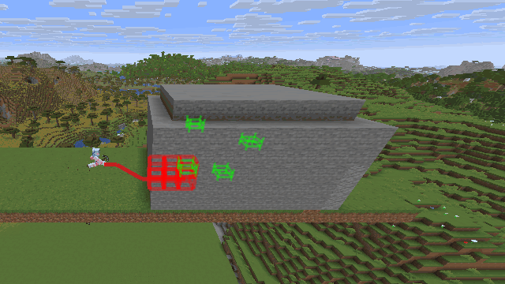
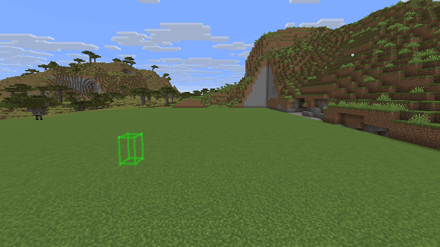

<p align="center">
  
</p>

<p align="center">
  basso is Google Maps, but for <a href="https://github.com/horizon-rust/horizon">Horizon</a>, basically
  Minecraft Rust Edition.<br>Tell it where to go, what to mine or who to follow, and it plays the game to get there.
</p>

<p align="center">
  
</p>

It behaves just like [Baritone](https://github.com/cabaletta/baritone), but in Rust, running inside Horizon (and
since Baritone is a voice range, basso is the next one down). It started as a fork of
[Azalea](https://github.com/azalea-rs/azalea), which is a Rust library for Minecraft bots.

It is also very useful for agents that need to play the game, for example to test various things in Horizon: they
give basso an order and it does the walking, digging and following for them.

## Quick start

1. In the Horizon launcher, open **Mods**, click **Add from GitHub** and paste `https://github.com/luniiya/basso`.
   It installs the [latest release](https://github.com/luniiya/basso/releases/latest). From a terminal:
   `horizon-launcher mods add-github https://github.com/luniiya/basso --trust-native-code`.
2. Open a single-player world.
3. In chat:

```
/basso goto 100 64 -200      walk there
/basso mine 16 iron_ore      mine 16 iron ore
/basso follow player Steve   follow a player
/basso cancel                stop
```

## What it does

- **Goto**: walks, sprints, jumps, parkours, swims, climbs ladders and vines, falls safely (MLG water bucket), pillars
  up, bridges and digs through what is in the way.
- **Mine**: finds every known block of the kinds you ask for, highlights them, digs to them with the best tool and
  picks up the drops; explores when none is known.
- **Follow**: players, any living entity, or given kinds or names.
- **Click mode**: point at a block and click to go there.
- **Free camera**: watch basso from outside while it plays.
- **Rendering**: the path, the goal and the blocks it is after are drawn in the world, through walls.

<p align="center">
  
  
</p>

<p align="center">
  Left: <code>/basso mine 4 diamond_ore</code>. Right: a long fall landed in a water bucket.<br>
  All the clips are filmed with basso's free camera.
</p>

## Commands

| Command | What |
| --- | --- |
| `/basso goto <x> <y> <z>` / `<x> <z>` / `<y>` / `<block>` | Go to coordinates, or to the nearest matching block |
| `/basso mine [count] <block...>` | Mine matching blocks, optionally stopping after `count` mined |
| `/basso follow entities \| players \| entity <kind...> \| player <name...>` | Follow living entities, players, kinds or names |
| `/basso pause` / `resume` / `cancel` / `paused` | Pause, resume, cancel the current order, or tell whether paused |
| `/basso click` | Toggle click mode: left click goes into the block you point at, right click onto it |
| `/basso set [setting] [value]` / `toggle <setting>` | List, show or change settings |
| `/basso help [command]` | Help |

Every command tab-completes.

### Settings

| Setting | What |
| --- | --- |
| `allowBreak` | Break blocks that are in the way |
| `allowPlace` | Place blocks to pillar up and bridge |
| `allowParkour` | Jump gaps |
| `autoTool` | Switch to the best tool in the hotbar before breaking |
| `mlgWaterBucket` | Land long falls in a water bucket |
| `mineScanDroppedItems` | Pick up drops while mining |
| `exploreForBlocks` | Explore when no block of the kind asked for is known |
| `freecam` | Free camera while basso is active |
| `verbose` | How much basso says in chat, 0 to 3 |

## Status

basso is young (0.1). Goto, mine and follow work and are tested in game, but it is rougher than Baritone, and
Baritone's other processes (build, farm, schematics...) are not there yet.

- **Single player.** basso is a single-player and testing tool. It has no anticheat bypass of any kind.
- **Pinned to a Horizon commit.** It is a native mod compiled into the game, tested on the Horizon commit in
  `horizon-mixin.toml` (`[compatibility]`); the launcher may move your game to that commit or ask before building.
- **Native code.** Native mods run with your rights, not in a sandbox: read the source before you build it.

Found a bug or something it does worse than Baritone? [Open an issue](https://github.com/luniiya/basso/issues).

## Contributing

Contributions are welcome: bug reports, ideas, and pull requests big or small.

- **Bugs and ideas**: open an [issue](https://github.com/luniiya/basso/issues). For a bug, say what you asked basso
  to do, what it did, and the seed or coordinates if you have them.
- **Pull requests**: fork, branch, and open a PR against `main`. Keep it to one change; say what it fixes and how you
  tested it.
- **Tests**: run `cargo test` before you open the PR. Every new function, fix or behaviour gets unit tests, and a fix gets a test that fails without it. Changes to
  in-game behaviour also get a scenario in `scripts/ingame/` (`all.sh` runs them all through Horizon's control
  socket).
- **Porting from Baritone**: basso follows Baritone's behaviour, names and settings, but contains no Baritone code.
  Re-implement from how Baritone behaves; don't copy its source (it is LGPL).

### Layout

- `horizon-mixin.toml`, `mixins/basso/`: the Horizon bundle. `adapter.rs` is all the glue (world, keys, mouse,
  camera, chat, rendering); the other helpers are one-line hooks into it.
- `basso-engine/`: the pathfinder, with no Horizon types and no dependencies: search, moves, costs, goals, execution,
  mining, following, commands and settings.
- `scripts/ingame/`: in-game test scenarios.
- `scripts/package.py`: builds `target/basso-<version>.hnmod` for a release.
- `scripts/apply-check.sh`: whether the bundle applies on another Horizon commit, as the registry's Nightly check
  applies it.
- `assets/branding/`: the icon and the wordmark; `make-icon.sh` and `make_wordmark.py` redraw them.
- `assets/previews/`: the GIFs in this README.

Build from source with `horizon-launcher native-build <this folder> --trust-native-code`.

## Credits

- [Baritone](https://github.com/cabaletta/baritone) by cabaletta and its contributors: basso's goal, behaviour,
  commands and settings follow Baritone's. basso contains no Baritone code.
- [Azalea](https://github.com/azalea-rs/azalea) by mat and its contributors (MIT): basso started as a fork of
  Azalea, whose pathfinder is already Baritone-style. basso does not track upstream.

## License

MIT, see [LICENSE.md](LICENSE.md). Azalea's copyright notice is kept there.
