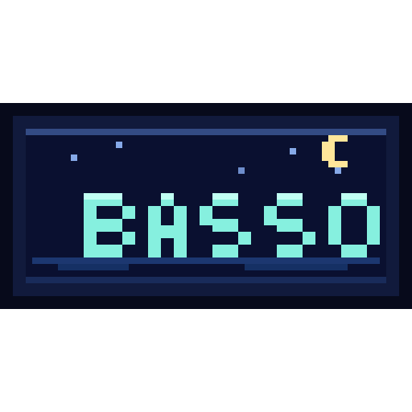

# basso

A pathfinding bot for [Horizon](https://github.com/horizon-rust/horizon), the Rust reimplementation of Minecraft Java
Edition. It is pretty much [Baritone](https://github.com/cabaletta/baritone), in Rust, running inside Horizon.

Baritone is a voice range; basso is the next one down.

## What it does

- **Goto**: walks, sprints, jumps, parkours, swims, climbs ladders and vines, falls safely (MLG water bucket), pillars
  up, bridges and digs through what is in the way.
- **Mine**: finds every known block of the kinds you ask for, highlights them, digs to them with the best tool and
  picks up the drops; explores when none is known.
- **Follow**: players, any living entity, or given kinds or names.
- **Click mode**: point at a block and click to go there.
- **Free camera**: watch basso from outside while it plays.
- Path, goal and target rendering in the world.

## Commands

| Command | What |
| --- | --- |
| `/basso goto <x> <y> <z>` / `<x> <z>` / `<y>` / `<block>` | Go to coordinates, or to the nearest matching block |
| `/basso mine [count] <block...>` | Mine matching blocks, optionally stopping after `count` mined |
| `/basso follow entities \| players \| entity <kind...> \| player <name...>` | Follow living entities, players, kinds or names |
| `/basso pause` / `resume` / `cancel` / `paused` | Pause, resume, cancel the current order, or tell whether paused |
| `/basso click` | Toggle click mode: left click goes into the block you point at, right click onto it |
| `/basso set [setting] [value]` / `toggle <setting>` | List, show or change settings |
| `/basso help [command]` | Help |

Settings: `allowBreak`, `allowPlace`, `allowParkour`, `autoTool`, `mlgWaterBucket`, `mineScanDroppedItems`,
`exploreForBlocks`, `freecam`, and `verbose` (0-3).

## Install

basso is a native Horizon mod (a [horizon-mixins](https://github.com/horizon-rust/horizon-mixins) bundle): the launcher
compiles it into the game. It pins the Horizon commit it is tested on (`horizon-mixin.toml`, `[compatibility]`).

- From a release: download `basso-<version>.hnmod` from the
  [releases](https://github.com/luniiya/basso/releases), or install it from the GitHub link in the launcher.
- From source: `horizon-launcher native-build <this folder> --trust-native-code`.

Native mods run with your rights, not in a sandbox: read the source before you build it. basso is a single-player
and testing tool; it has no anticheat bypass of any kind.

## Layout

- `horizon-mixin.toml`, `mixins/basso/`: the Horizon bundle. `adapter.rs` is all the glue (world, keys, mouse,
  camera, chat, rendering); the other helpers are one-line hooks into it.
- `basso-engine/`: the pathfinder with no Horizon types and no dependencies: search, moves, costs, goals, execution,
  mining, following, commands and settings.
- `basso-*` crates: the rest of the Azalea codebase basso grew from (world, physics, blocks, registries), kept for
  its simulation tests and the data bump to newer versions.
- `scripts/ingame/`: in-game test scenarios driven through Horizon's control socket (`all.sh` runs them all).
- `scripts/package.py`: packs the bundle into `target/basso-<version>.hnmod` for a release.

## Tests

Run the tests for everything you change (`cargo test -p <crate>`, and `cargo test --workspace` before calling a task
done), and write as many unit tests as possible: every new function, fix or behaviour gets tests, a fix gets one that
fails without it. Never call work done while a test fails.

## Credits

- [Baritone](https://github.com/cabaletta/baritone) by cabaletta and its contributors: basso's goal, behaviour,
  commands and settings follow Baritone's. basso contains no Baritone code.
- [Azalea](https://github.com/azalea-rs/azalea) by mat and its contributors (MIT): basso is a hard fork of Azalea's
  codebase, whose pathfinder is already Baritone-style. basso does not track upstream.

## License

MIT, see [LICENSE.md](LICENSE.md). Azalea's copyright notice is kept there.
